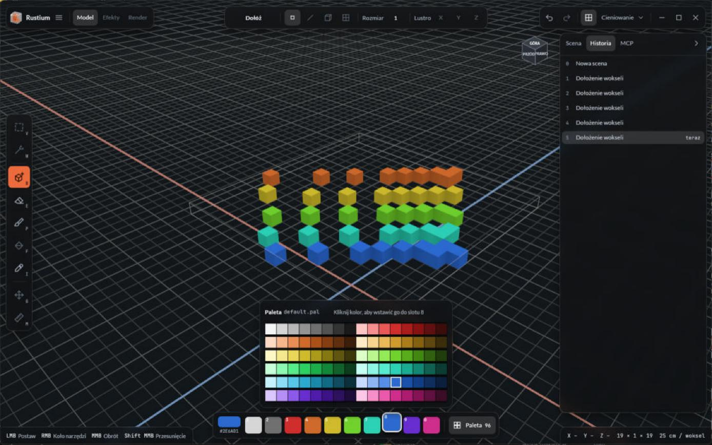
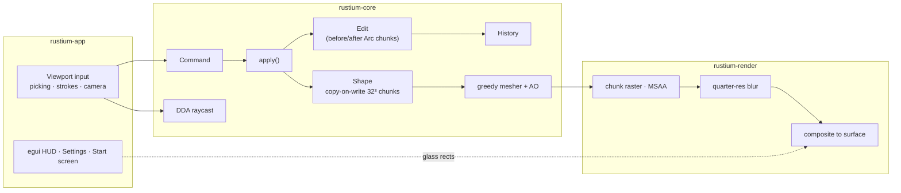

<div align="center">


# Rustium

**A voxel model editor written in Rust, with its own wgpu renderer and a viewport-first interface.**

[](https://doc.rust-lang.org/edition-guide/rust-2024/)
[](https://wgpu.rs)
[](https://github.com/emilk/egui)
[](LICENSE)


</div>

---

## Why Rustium

Most voxel editors make you choose: a polished UI or a renderer you can trust and extend. Rustium aims for both.

- 🧊 **Unbounded models.** Shapes grow in any direction, stored as copy-on-write 32³ chunks. Undo costs only the chunks you touched.
- ⚡ **Own renderer.** Greedy-meshed chunks rasterized with MSAA for editing. A compute path tracer for final renders is next ([ADR 0001](docs/adr/0001-hybrid-renderer.md)).
- 🪟 **Viewport-first HUD.** Floating glass islands over a full-window viewport, with real backdrop blur, a frameless window and keyboard-first tools.
- 🎨 **PBR-ready palette.** One byte per voxel, 255 Colors per Scene, `.vox`-compatible by design.
- 🤖 **Built for automation.** Every edit is a `Command`, the same API that the planned MCP server and Luau scripts will use.
- 🌍 **Polish and English** from day one, through Fluent.

## Screenshots

<table>
  <tr>
    <td width="50%"></td>
    <td width="50%"></td>
  </tr>
  <tr>
    <td align="center"><sub>Start screen</sub></td>
    <td align="center"><sub>96-color palette and the History tab: click any step to jump back</sub></td>
  </tr>
</table>

<sub>Screenshots show the Polish interface; switch languages in Settings → General.</sub>

## Features

### Available now (M1)

| Area | What you get |
|---|---|
| **Editing** | Attach, Erase and Paint with Voxel, Line, Box and Face brushes (1–64 voxels), surface and 3D Fill, live Mirror X/Y/Z, Select box / by color, Move, Measure, Pick color. A drag stroke is one undo step. Attach strokes stay on their starting plane, so they never stack toward the camera. |
| **Scene** | Groups, Models and Instances with a tree in the inspector (hide, lock, rename, drag to reparent, ×N instance counters), Duplicate / Duplicate as Instance / Make Unique / Merge / Split, step into a Node with Enter and out with Esc; the rest of the Scene dims while you edit. |
| **History** | Undo / redo (`Ctrl Z`, `Ctrl Y`), a configurable step limit, and a History tab where clicking any step jumps there. |
| **Colors** | 10-slot hotbar on keys `1`–`0` and a 96-color palette popover. |
| **Viewport** | Orbit (turntable or free), pan, zoom to cursor, perspective / orthographic, view cube with click-to-snap, ground grid, Volume bounds, hover preview of the brush. |
| **Rendering** | wgpu 30, MSAA off / 2× / 4× / 8×, ambient occlusion baked into greedy meshes, sun-and-sky lighting, quarter-resolution glass blur behind panels. |
| **Window** | Frameless window with HUD buttons, drag zone along the top, resizable edges, drop shadow on Windows. |
| **Settings** | General, Interface (accent color, UI scale 75–200 %, motion, translucent panels), Viewport, Input and Performance (graphics backend, vsync, frame limit). Changes apply immediately and are saved as TOML. |
| **Language** | English and Polish. |

### Roadmap

| Milestone | Scope | Status |
|---|---|---|
| **M1** | Core data model, renderer, HUD, Settings, start screen, i18n | ✅ done |
| **M2** | Scene graph (Groups, Instances, Step in/out), Line/Box/Face brushes, Fill, Mirror, selection, Move, Measure, tool wheel, **MCP server** (HTTP + stdio), **Luau scripting** | 🛠️ next |
| **M3** | PBR Materials tab, compute path tracer (DDA), Render mode with Shots, camera, light and PNG/EXR output | 📋 planned |
| **M4** | Glass and haze in the path tracer, dithered transparency + TAA, Clay/Toon/Pixel/Wire styles, denoise, DOF, turntable via `ffmpeg` | 📋 planned |
| **M5** | `.ruv` save/load, MagicaVoxel `.vox` import/export, `.pal`, autosave and recovery, key rebinding | 📋 planned |
| **M6** | Hardware ray-query backend | 📋 planned |

## Controls

| Input | Action |
|---|---|
| `LMB` | Use the active Tool (drag to paint a stroke) |
| `MMB` drag | Orbit |
| `Shift` + `MMB` drag | Pan |
| Wheel | Zoom toward the cursor |
| `B` / `E` / `P` / `I` | Attach / Erase / Paint / Pick color |
| `1` … `0` | Color slots |
| `Ctrl Z` / `Ctrl Y` | Undo / Redo |
| `Ctrl N` | New model |
| `Ctrl ,` | Settings |
| `Home` | Frame the model |
| Drag the top strip | Move the window (double-click to maximize) |

## Getting started

You need a recent stable Rust toolchain (`rust-toolchain.toml` pins `stable`) and a GPU with Vulkan, DirectX 12 or Metal.

```bash
git clone https://github.com/mzak-dev/Rustium.git
cd Rustium
cargo run -p rustium-app --release
```

Logs go to the platform data directory (`%LOCALAPPDATA%\mzak\Rustium\data\logs` on Windows) and, in debug builds, to the console. Override the filter with `RUST_LOG`, for example `RUST_LOG=rustium=debug,wgpu=warn`.

## Architecture



| Crate | Responsibility |
|---|---|
| [`rustium-core`](crates/rustium-core) | Scene, Shape, Palette, Commands and Edits, History, raycast, meshing. No GPU, no async. |
| [`rustium-render`](crates/rustium-render) | wgpu device and surface, chunk raster, grid, overlays, glass blur and composite. |
| [`rustium-app`](crates/rustium-app) | The `rustium` binary: winit, egui interface, i18n, camera, settings, logging. |

Further reading:
- [ARCHITECTURE.md](ARCHITECTURE.md): how a frame flows and the coordinate conventions.
- [GLOSSARY.md](GLOSSARY.md): the project's vocabulary (Scene, Model, Shape, Volume, Edit…).
- [docs/adr](docs/adr): ten architecture decisions with their trade-offs.

## Development

The code follows the mzak-dev Rust style guide: edition 2024, workspace lints with pedantic Clippy, a no-panic policy for GUI crates, and documented public items. Before sending changes:

```bash
cargo +nightly fmt --all -- --check
cargo clippy --workspace --all-targets --all-features -- -D warnings
cargo test --workspace --all-features
RUSTDOCFLAGS="-D warnings" cargo doc --workspace --no-deps
```

The tests include property tests for the greedy mesher (it must cover exactly the exposed faces), undo/redo identity checks on shared chunks, and naga validation of every WGSL shader. To benchmark meshing:

```bash
cargo bench -p rustium-core
```

## License

Rustium is licensed under the [Apache License 2.0](LICENSE).

Bundled fonts keep their own licenses: [Lato](crates/rustium-app/assets/fonts/OFL-Lato.txt) and [JetBrains Mono](crates/rustium-app/assets/fonts/OFL-JetBrainsMono.txt), both under the SIL Open Font License 1.1.
