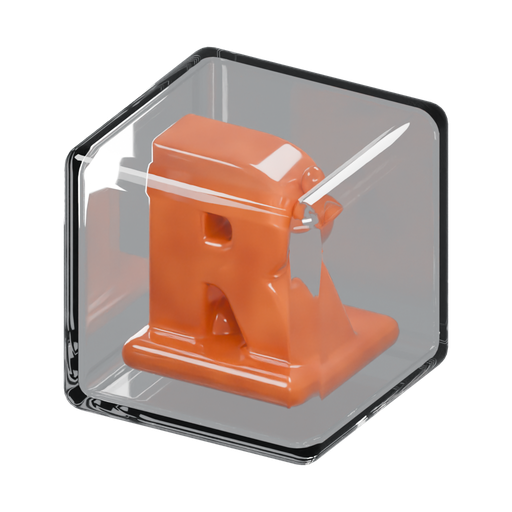
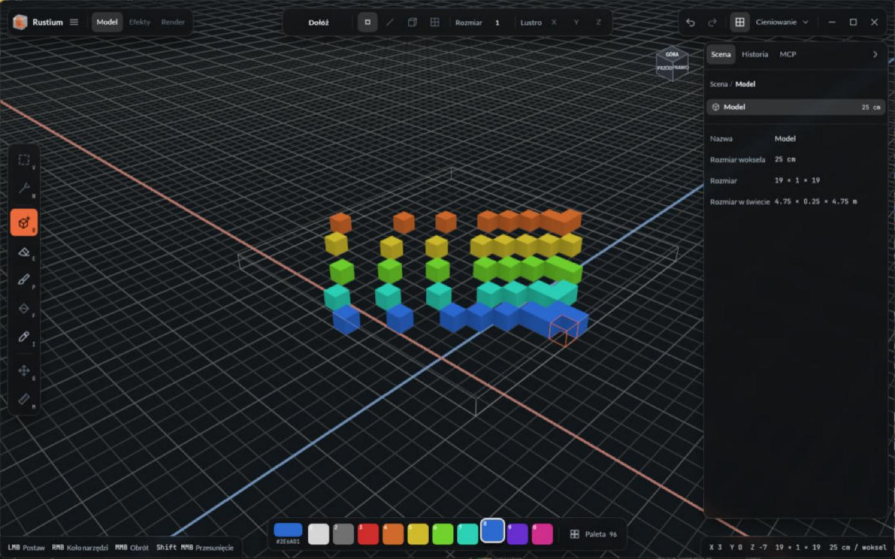
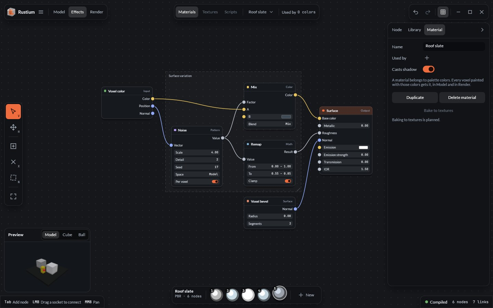
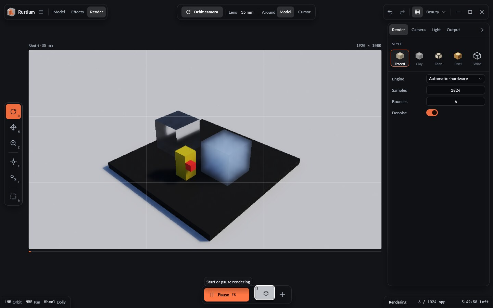
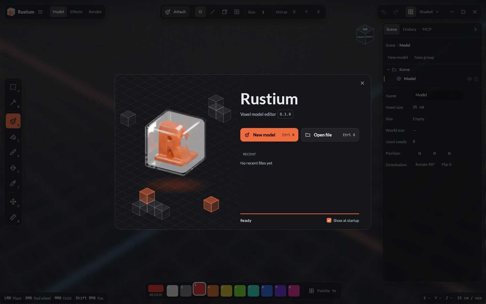
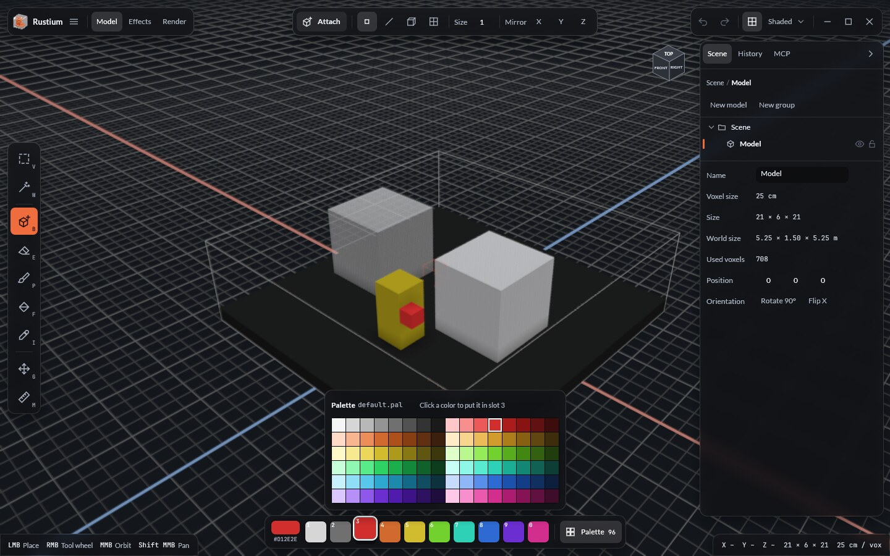
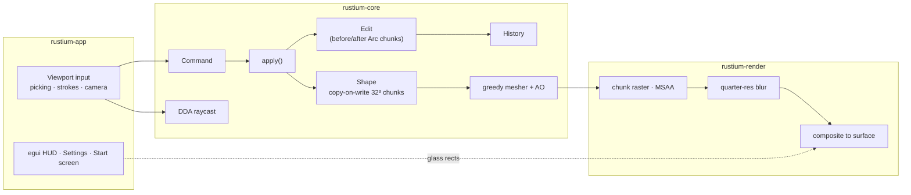

<div align="center">



# Rustium

**A voxel model editor written in Rust, with its own wgpu renderer and a viewport-first interface.**

[](https://doc.rust-lang.org/edition-guide/rust-2024/)
[](https://wgpu.rs)
[](https://github.com/emilk/egui)
[](LICENSE)




</div>

---

## Why Rustium

Most voxel editors make you choose: a polished UI or a renderer you can trust and extend. Rustium aims for both.

- 🧊 **Unbounded models.** Shapes grow in any direction, stored as copy-on-write 32³ chunks. Undo costs only the chunks you touched.
- ⚡ **Own renderer.** Binary-greedy-meshed chunks rasterized with MSAA and temporal anti-aliasing for editing, and a progressive compute path tracer (software DDA or hardware ray query) for final renders ([ADR 0001](docs/adr/0001-hybrid-renderer.md), [ADR 0013](docs/adr/0013-ray-query-backend.md)).
- 🎨 **Node-graph Materials.** One byte per voxel picks a palette Color; each Color points at a Material, a node graph compiled to WGSL, so the editor and the render show the same procedural detail ([ADR 0012](docs/adr/0012-node-graph-materials.md)).
- 🪟 **Viewport-first HUD.** Floating glass islands over a full-window viewport, with real backdrop blur, a frameless window (Snap Layouts on Windows 11) and rebindable keyboard-first tools.
- 🤖 **Built for automation.** Every edit is a `Command`, the same API that the built-in MCP server and sandboxed Luau scripts use.
- 🌍 **Polish and English** from day one, through Fluent.

## Screenshots

<table>
  <tr>
    <td width="50%"></td>
    <td width="50%"></td>
  </tr>
  <tr>
    <td align="center"><sub>Effects mode: Materials are node graphs compiled to WGSL</sub></td>
    <td align="center"><sub>Render mode: progressive path tracer with glass and haze</sub></td>
  </tr>
  <tr>
    <td width="50%"></td>
    <td width="50%"></td>
  </tr>
  <tr>
    <td align="center"><sub>Start screen</sub></td>
    <td align="center"><sub>96-color palette: click a color to put it in the active slot</sub></td>
  </tr>
</table>

<sub>The interface is also available in Polish; switch languages in Settings → General.</sub>

## Features

| Area | What you get |
|---|---|
| **Editing** | Attach, Erase and Paint with Voxel, Line, Box and Face brushes (1–64 voxels), surface and 3D Fill, live Mirror X/Y/Z, Select box / by color, Move, Measure, Pick color, tool wheel on `RMB`. A drag stroke is one undo step. |
| **Scene** | Groups, Models and Instances in a tree (hide, lock, rename, drag to reparent, ×N instance counters), Duplicate / Duplicate as Instance / Make Unique / Merge / Split, step into a Node with `Enter` and out with `Esc`; the rest of the Scene dims while you edit. |
| **Materials (Effects mode)** | A node editor drawn with egui: Voxel color, Ambient occlusion, Value, Noise, Cells, Gradient, Edge wear, Mix, Color ramp, Hue shift, Remap, Multiply, Clamp, Voxel bevel, Surface output (with transmission and IOR) and Volume output. Typed sockets, frames, bypass, snap to grid, Model / Cube / Ball preview, eight starter Materials, assignment to palette Colors. Graphs compile to WGSL in the background; tweaking a value never recompiles. |
| **Rendering** | Path tracer with progressive accumulation, glass (Fresnel, refraction, rough glass), haze (participating media), emission, sun and sky presets, ground None / Studio / Shadow catcher, styles Traced / Clay / Toon / Pixel / Wire, edge-aware denoiser, depth of field with a Focus tool, exposure, Beauty / Albedo / Normal / Depth passes, render region, frame guides. Software DDA or hardware ray query. |
| **Output** | Shots 1–5, PNG and EXR, transparent background, turntable MP4 through `ffmpeg` (PNG sequence without it), Queue all shots — all on a worker thread with progress and Cancel. |
| **Files** | `.ruv` scenes (versioned, compressed), MagicaVoxel `.vox` import / export, `.pal` palettes, autosave with a Recovery file offered after a crash, recent files on the start screen, dirty tracking with a "Save changes?" prompt. |
| **Automation** | In-process MCP server (streamable HTTP on `127.0.0.1:7420` plus `--mcp-stdio`) with five permission switches, and sandboxed Luau scripts; every call lands in History as one step. |
| **History** | Undo / redo (`Ctrl Z`, `Ctrl Y`), a configurable step limit, and a History tab where clicking any step jumps there. Material graph edits are undoable too. |
| **Viewport** | Orbit (turntable or free), pan, zoom to cursor, perspective / orthographic, view cube with click-to-snap, ground grid, Volume bounds, brush preview, MSAA off / 2× / 4× / 8×, dithered transparency with TAA. |
| **Settings** | General, Interface (accent color, UI scale 75–200 %, motion, translucent panels), Viewport, Input (rebind every shortcut, conflict detection, keymap import / export), Performance (graphics backend, ray tracing engine, vsync, frame limit) and MCP. Changes apply immediately and are saved as TOML. |
| **Language** | English and Polish. |

### Roadmap

| Milestone | Scope | Status |
|---|---|---|
| **M1** | Core data model, renderer, HUD, Settings, start screen, i18n | ✅ done |
| **M2** | Scene graph, brushes, Fill, Mirror, selection, Move, Measure, tool wheel, MCP server, Luau scripting | ✅ done |
| **M3** | Compute path tracer (DDA), Render mode with Shots, camera, light and PNG/EXR output | ✅ done |
| **M4** | Effects → Materials: node graphs compiled to WGSL, node editor | ✅ done |
| **M5** | Glass and haze, dithered transparency + TAA, Clay/Toon/Pixel/Wire, denoise, DOF, turntable via `ffmpeg`, render queue | ✅ done |
| **M6** | `.ruv`, `.vox`, `.pal`, autosave and recovery, recent files, key rebinding | ✅ done |
| **M7** | Hardware ray-query backend | ✅ done |
| **Later** | Effects → Textures (bake Materials to PBR maps, glTF export), Effects → Scripts | 📋 planned |

## Controls

Every shortcut can be rebound in Settings → Input; these are the defaults.

| Input | Action |
|---|---|
| `LMB` | Use the active Tool (drag to paint a stroke) |
| `RMB` | Tool wheel |
| `MMB` drag | Orbit |
| `Shift` + `MMB` drag | Pan |
| Wheel | Zoom toward the cursor |
| `V` / `W` / `B` / `E` / `P` / `F` / `I` / `G` / `M` | Select box / Select by color / Attach / Erase / Paint / Fill / Pick color / Move / Measure |
| `1` … `0` | Color slots (Materials in Effects mode) |
| `Enter` / `Esc` | Step into / out of a Node |
| `Ctrl Z` / `Ctrl Y` | Undo / Redo |
| `Ctrl N` / `Ctrl O` / `Ctrl S` / `Ctrl Shift S` | New / Open / Save / Save as |
| `Ctrl ,` | Settings |
| `Home` | Frame the model (fit the graph in Effects mode) |
| `F5` | Start or pause a render (Render mode) |
| `Tab` / `X` / `N` | Add node / Cut links / Frame nodes (Effects mode) |
| Drag the top strip | Move the window (double-click to maximize) |

## Getting started

You need a recent stable Rust toolchain (`rust-toolchain.toml` pins `stable`) and a GPU with Vulkan, DirectX 12 or Metal.

```bash
git clone https://github.com/mzak-dev/Rustium.git
cd Rustium
cargo run -p rustium-app --release
```

Open a scene directly with `rustium path/to/scene.ruv`. Turntable videos need `ffmpeg` on `PATH`; without it Rustium writes a PNG sequence. The hardware ray-query engine needs a Vulkan GPU with ray query support (Settings → Performance → Ray tracing; Automatic falls back to the software DDA).

Logs go to the platform data directory (`%LOCALAPPDATA%\mzak\Rustium\data\logs` on Windows) and, in debug builds, to the console. Override the filter with `RUST_LOG`, for example `RUST_LOG=rustium=debug,wgpu=warn`.

## Architecture



| Crate | Responsibility |
|---|---|
| [`rustium-core`](crates/rustium-core) | Scene, Shape, Palette, Material graphs, Commands and Edits, History, raycast, meshing, `.ruv` / `.vox` / `.pal`. No GPU, no async. |
| [`rustium-render`](crates/rustium-render) | wgpu device and surface, chunk raster with MSAA and TAA, glass blur and composite, Material graph compiler, path tracer (DDA and ray query), denoiser, offline renderer. |
| [`rustium-mcp`](crates/rustium-mcp) | MCP server over HTTP and the stdio bridge; the only crate with tokio. |
| [`rustium-script`](crates/rustium-script) | Sandboxed Luau scripting through mlua. |
| [`rustium-platform`](crates/rustium-platform) | Win32 hit-testing for the frameless window; the only crate with `unsafe`. |
| [`rustium-app`](crates/rustium-app) | The `rustium` binary: winit, egui interface, i18n, camera, keymap, files, render jobs, settings, logging. |

Further reading:
- [ARCHITECTURE.md](ARCHITECTURE.md): how a frame flows and the coordinate conventions.
- [GLOSSARY.md](GLOSSARY.md): the project's vocabulary (Scene, Model, Shape, Volume, Edit…).
- [docs/adr](docs/adr): fourteen architecture decisions with their trade-offs.
- [docs/releasing.md](docs/releasing.md): how versions, the changelog and release packages are produced.

## Development

The code follows the mzak-dev Rust style guide: edition 2024, workspace lints with pedantic Clippy, a no-panic policy for GUI crates, and documented public items. Before sending changes:

```bash
cargo +nightly fmt --all -- --check
cargo clippy --workspace --all-targets --all-features -- -D warnings
cargo test --workspace --all-features
RUSTDOCFLAGS="-D warnings" cargo doc --workspace --no-deps
```

The tests include property tests for the greedy mesher (it must cover exactly the exposed faces), undo/redo identity checks on shared chunks, and naga validation of every WGSL shader. To benchmark meshing:

```bash
cargo bench -p rustium-core
```

## Releases

Prebuilt packages for Windows, Linux and macOS are on the [Releases](https://github.com/mzak-dev/Rustium/releases) page. Versions are not edited by hand: commit messages follow [Conventional Commits](https://www.conventionalcommits.org/) (`feat:` bumps the minor version, `fix:` the patch), a bot keeps a release PR with the next version and changelog, and merging it builds and publishes the release. See [docs/releasing.md](docs/releasing.md).

## License

Rustium is licensed under the [Apache License 2.0](LICENSE).

Bundled fonts keep their own licenses: [Lato](crates/rustium-app/assets/fonts/OFL-Lato.txt) and [JetBrains Mono](crates/rustium-app/assets/fonts/OFL-JetBrainsMono.txt), both under the SIL Open Font License 1.1.
