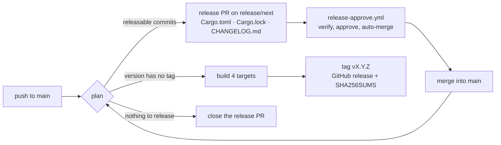

# Releasing

Releases are automatic. Commit messages (or squash-merged PR titles) follow [Conventional Commits](https://www.conventionalcommits.org/); the release workflow turns them into a version bump, a changelog entry, packages for every platform and a GitHub release. Nobody edits the version in `Cargo.toml` by hand.



## Commit messages and versions

```
<type>(<optional scope>)<optional !>: <description>

<optional body>

<optional footer, e.g. BREAKING CHANGE: what breaks and how to migrate>
```

| Commit | Bump | Example (from 0.4.2) |
|---|---|---|
| `!` after the type, or a `BREAKING CHANGE:` footer | major; **minor while the version is 0.x** | `feat(core)!: drop the v1 .ruv reader` → 0.5.0 |
| `feat` | minor | `feat(app): tool wheel on right click` → 0.5.0 |
| `fix`, `perf`, `revert` | patch | `fix(render): keep TAA history on resize` → 0.4.3 |
| `docs`, `style`, `refactor`, `test`, `build`, `ci`, `chore` | none | `docs: refresh screenshots` → no release |

The highest bump among the commits since the last `v*` tag wins. All crates share `[workspace.package] version`, so the whole workspace moves together. PR titles are checked by `pr-title.yml`, because a squash merge uses the title as the commit message. Scopes in use: `app`, `core`, `render`, `mcp`, `script`, `platform`.

## What the workflows do

| Workflow | Trigger | Job |
|---|---|---|
| `ci.yml` | PRs, pushes to main, merge queue | nightly rustfmt; Clippy with `-D warnings` and tests on Windows, Linux (with lavapipe, so the GPU tests run) and macOS; rustdoc with `-D warnings`; the release tooling's tests. `CI success` collects them for branch protection. |
| `pr-title.yml` | PR opened or edited | the title is a Conventional Commit header |
| `release.yml` | push to main, manual | `plan`, then either the release PR or build and publish (below) |
| `release-approve.yml` | the release PR is opened or updated | verify the bump, approve, optionally enable auto-merge |

`scripts/release.py plan` decides, from the commit on main and the tags only:

- **release**: the version in `Cargo.toml` has no `v` tag yet (and differs from the version the repository started with, unless forced). The workflow builds `rustium` for `x86_64-pc-windows-msvc`, `x86_64-unknown-linux-gnu` (built on Ubuntu 24.04, needs glibc 2.39), `aarch64-apple-darwin` and `x86_64-apple-darwin`, packs each with `scripts/package.sh` (`.zip` on Windows, `.tar.gz` elsewhere; fonts, icons and locales are compiled in), attests build provenance on public repositories, then creates the tag on that commit and the release with the archives, `SHA256SUMS.txt` and the changelog section as notes. A failed run is retried by re-running it or by the next push, because the version still has no tag.
- **pr**: there are releasable commits since the last tag. The workflow resets `release/next` to main, runs `scripts/release.py prepare` (version in `Cargo.toml`, the workspace crates in `Cargo.lock`, a new section at the top of `CHANGELOG.md`), force-pushes it and opens or updates the PR `chore(release): vX.Y.Z`. Every push to main rebuilds it, so it always covers everything unreleased.
- **none**: nothing releasable; a leftover release PR is closed.

### Auto-approval

`release-approve.yml` approves the release PR only when all of these hold, checked by `scripts/release.py verify-pr` running from **main's** copy of the script (the PR's own code is never executed):

1. the PR comes from this repository's `release/next` and was opened by the release app (`RELEASE_BOT_LOGIN`);
2. it is exactly one commit on top of main;
3. it changes nothing but `Cargo.toml`, `Cargo.lock` and `CHANGELOG.md`;
4. parsed as TOML, `Cargo.toml` differs only in `[workspace.package] version` and `Cargo.lock` only in the versions of the workspace crates, so no dependency, source or checksum can ride along;
5. the new version is exactly the one the commits since the last tag call for, and earlier changelog sections are unchanged.

The approval is given by `github-actions[bot]`, a different identity from the app that opened the PR (GitHub does not let authors approve their own PRs). CI still has to pass before the PR can merge.

## One-time setup

1. **Create a GitHub App** (Settings → Developer settings → GitHub Apps → New), e.g. `rustium-release`. No webhook. Repository permissions: *Contents: Read and write*, *Pull requests: Read and write* (Metadata: read is implied). Install it on this repository only. The workflows need it because pushes made with `GITHUB_TOKEN` do not start other workflows (the release PR would never get CI), and because `github-actions[bot]` cannot approve a PR it opened itself.
2. **Generate a private key** for the app and note its **Client ID**.
3. In the repository, **Settings → Secrets and variables → Actions**:
   - secret `RELEASE_APP_PRIVATE_KEY`: the `.pem` file's contents;
   - variable `RELEASE_APP_CLIENT_ID`: the app's Client ID;
   - variable `RELEASE_BOT_LOGIN`: `<app-slug>[bot]`, e.g. `rustium-release[bot]`;
   - optional variable `RELEASE_AUTO_MERGE`: `true` to merge the release PR as soon as CI passes (every releasable change then ships on its own); leave it unset to approve automatically but merge by hand, which lets several changes go out together;
   - optional variable `RELEASE_MERGE_METHOD`: `squash` (default), `merge` or `rebase`.
4. **Settings → Actions → General → Workflow permissions**: tick *Allow GitHub Actions to create and approve pull requests*.
5. For auto-merge: **Settings → General → Pull Requests**: tick *Allow auto-merge*.
6. **Branch protection or a ruleset for `main`**: require a pull request with 1 approval and the status checks `CI success` and `Conventional PR title`. Leave *Require review from Code Owners* off for `release/next` PRs (or exclude `Cargo.toml`, `Cargo.lock` and `CHANGELOG.md` from CODEOWNERS), since a bot approval does not count as a code owner's. If you use *Dismiss stale approvals*, the workflow approves again after each update. If tags are protected by a ruleset, allow GitHub Actions to create `v*` tags.

## First release and manual runs

Without tags, the first release PR covers the whole history from the version in `Cargo.toml` (0.1.0, so the first release is 0.2.0). To release 0.1.0 as it is first instead, run **Actions → Release → Run workflow** with *force* ticked: that tags and publishes the current version, and the release PR then starts from there.

Run the tooling locally from the repository root:

```bash
python3 scripts/release.py next-version          # what the next release would be
python3 scripts/release.py plan                  # what the workflow would do now
python3 scripts/release.py prepare               # write the bump into the working tree (do not commit it by hand)
python3 -m unittest discover -s scripts -v       # tests of the tooling
```

macOS builds are not signed or notarized; on first launch, right-click → Open, or run `xattr -d com.apple.quarantine rustium`.
